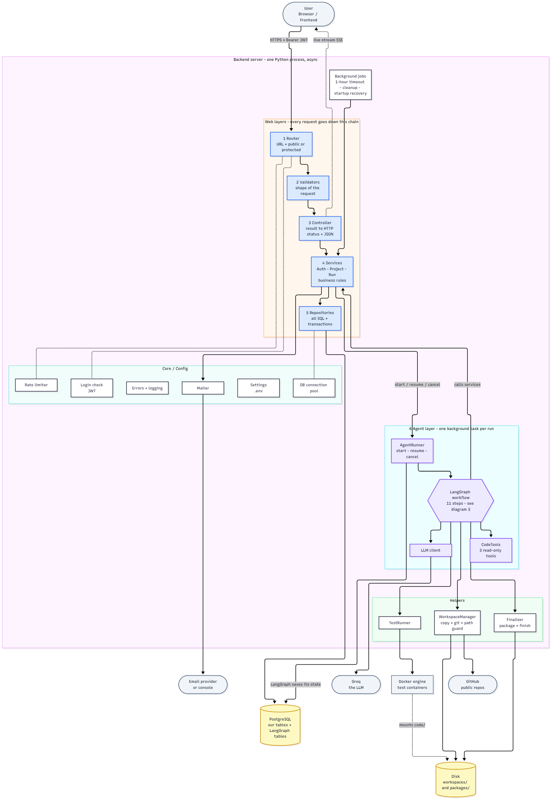
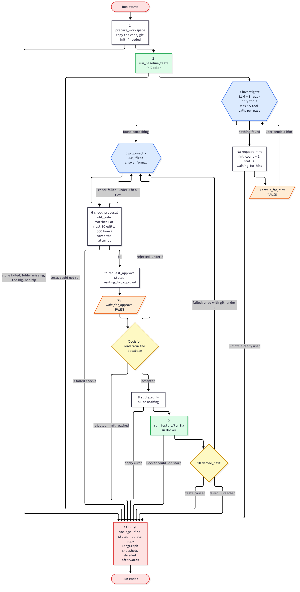

# SANGRA_AI

**An AI coding agent that fixes bugs, with a human in the loop.**

You describe a bug in plain English. SANGRA_AI searches your code, finds the wrong lines, shows you the fix,
**waits for your approval**, applies it to a safe copy, and runs your tests inside Docker. If the tests fail,
it undoes the change and tries again (up to 3 times). Your original code is never touched.

> **Status:** implementation in progress, phase by phase (see [the plan](06_implementation_plan.md) and
> [Implementation progress](#implementation-progress) below). Current phase: **FE0 Frontend project setup** (awaiting review). The backend (B0 to B11) is complete.

---

## Simple example

A junior developer is told: *"The summer sale shows 5% discount, it should be 10%."*
They do not read the whole codebase. They search for "discount", open only those files, find the wrong line,
ask a senior *"Can I change this?"*, make the change after approval, and run the tests.

SANGRA_AI does the same thing.



---

## How it works

1. **You give** the bug in English, the code (GitHub link, zip, or local folder), the language, and the test command.
2. **Safe copy:** the agent copies the code into a temporary workspace. The original is never changed.
3. **Baseline tests:** it runs your tests once *before* changing anything, so it knows what was already failing.
4. **Investigate:** the LLM searches the code with three **read-only** tools (`search_files`, `search_in_file`, `read_file_lines`).
5. **Propose a fix:** a list of exact edits (file, lines, old code, new code). Nothing is written yet.
6. **Check:** every edit is validated (path stays inside the workspace, old code matches exactly, size limits).
7. **Pause for you:** you see all changes side by side and click **Accept** or **Reject** (with feedback).
8. **Apply and test:** accepted edits are written and the tests run in a Docker container.
9. **Decide:** tests pass → done. Tests fail → undo with git and try again with the error (max 3 tries).
10. **Finish:** you get a download package (patch, changed files, test logs, summary). In local mode you can click
    **"Apply to my folder"**.

If the agent cannot find the bug, it asks you for a hint (max 3 times).



---

## Key design ideas

| Idea | Why |
|---|---|
| **The graph controls the flow, not the LLM** | LangGraph decides the order of steps. The LLM only moves freely inside the "investigate" step, with a 15-call limit. |
| **The LLM can only read** | Writing files, asking for approval, and running tests are graph steps, never LLM tools. Limits the damage of prompt injection. |
| **Human approval is a pause, not a tool** | The graph saves its state, waits for you, and resumes after your answer. |
| **Work on a copy; undo is always git** | If the copy is not a git repo, the agent runs `git init` inside the copy. Undo is one git command; the patch comes from `git diff`. |
| **Tests run in Docker** | Time, CPU, memory and output limits. No secrets passed in. Bad code can only damage the box. |
| **One active run per user** | Enforced by a partial unique index in the database, so two requests at the same moment cannot both pass. |
| **Hard limits** | 3 rejects, 3 failed-test tries, 3 hints, max 10 edits / 300 changed lines per attempt. |

---

## Tech stack

| Part | Choice |
|---|---|
| Backend | Python, FastAPI (async) |
| Agent | LangGraph (with the Postgres checkpointer for pause/resume) |
| LLM | Groq (`openai/gpt-oss-120b`, set in config so it is easy to swap) |
| Database | PostgreSQL, psycopg 3 (async), raw SQL in repositories, numbered `.sql` migrations |
| Auth | JWT (24 h) + bcrypt, email verification and password reset links |
| Live progress | Server-Sent Events (read with `fetch` so the JWT header can be sent) |
| Test runner | Docker (Docker SDK for Python), one image per language |
| Frontend | React + Vite, React Router, TanStack Query |
| Testing | pytest, Vitest + React Testing Library, MSW, Playwright, Locust |

Supported project languages: **Java** and **Python**.

---

## Architecture

The backend follows a strict layer order. The agent lives in its own module and calls the services, never the database directly.

```
Router -> Validators -> Controller -> Service -> Repository -> PostgreSQL
                                         ^
                                         |
                                Agent (LangGraph graph, nodes, read-only tools)
                                Runners (workspace manager, Docker test runner, finalizer)
                                Core (settings, DB pool, JWT, bcrypt, rate limiter, mailer, logging)
```

| Diagram | Shows |
|---|---|
| [d1_overview.png](diagrams/d1_overview.png) | The whole system, with the agent inside the backend |
| [d2_request.png](diagrams/d2_request.png) | One request through the layers (starting a run) |
| [d3_agent.png](diagrams/d3_agent.png) | The agent workflow (the LangGraph graph) |
| [d4_status.png](diagrams/d4_status.png) | The life of a run (its statuses) |
| [d5_pause.png](diagrams/d5_pause.png) | Pause and resume for approval |
| [d6_er.png](diagrams/d6_er.png) | Database tables and how they link |

The same diagrams are also in [workflow.md](workflow.md) as Mermaid (rendered by GitHub).

---

## Design documents

Read them in this order:

| # | Document | What it covers |
|---|---|---|
| 1 | [01_brainstorm.md](01_brainstorm.md) | The idea, the flow, decisions, safety rules, known limits |
| 2 | [02_tech_stack.md](02_tech_stack.md) | Stack choices, Groq model notes, storage plan for code copies and packages |
| 3 | [03_database_design.md](03_database_design.md) | 9 tables, columns, constraints, and how they link |
| 4 | [04_backend_design.md](04_backend_design.md) | All 7 backend layers: routes, validation, error codes, services, repositories, the agent, core |
| 5 | [05_frontend_design.md](05_frontend_design.md) | Screens and routes, API layer, auth state, data handling, the live Run page |
| 6 | [06_implementation_plan.md](06_implementation_plan.md) | Phases B0–B11 and FE0–FE7, with functional, failure, security, concurrency, recovery and load tests for each |
| – | [workflow.md](workflow.md) | The whole system as diagrams |

---

## Roadmap

| Phase | What gets built |
|---|---|
| B0 | Foundation: settings, app skeleton, errors, logging, CORS, health |
| B1 | Database: migrations, migration runner, connection pool |
| B2 | Security helpers: bcrypt, JWT, email tokens, mailer, rate limiter |
| B3 | Auth: register, login, verify, resend, forgot, reset, change password |
| B4 | Projects CRUD |
| B5 | Runs, events, state machine, live stream (with a fake agent) |
| B6 | Workspace manager and the 3 read-only code tools |
| B7 | Docker test runner |
| B8 | LLM client and prompts |
| B9 | The LangGraph agent: all 11 steps, pause and resume, limits |
| B10 | Package, download, apply to my folder, cleanup jobs |
| B11 | End-to-end, security sweep, soak and chaos tests |
| FE0–FE7 | Frontend: setup, API layer, auth, projects, runs, live Run page, result view, polish |
| Later | MCP server: a thin wrapper around the finished agent |

A phase is done only when all of its tests pass **and** all earlier tests still pass.

---

## Implementation progress

| Phase | State | Tests |
|---|---|---|
| B0 Foundation | Done (approved) | 49 of 49 pass |
| B1 Database and migrations | Done (approved) | 93 of 93 pass |
| B2 Security helpers, mailer, rate limiter, login check | Done (approved) | 29 of 29 pass |
| B3 Auth feature (8 routes) | Done (approved) | 48 of 48 pass |
| B4 Projects | Done (approved) | 46 of 46 pass |
| B5 Runs, events, state rules, live stream (fake agent) | Done (approved) | 100 of 100 pass |
| B6 Workspace manager and the 3 read-only code tools | Done (approved) | 61 of 61 pass |
| B7 Docker test runner | Done (approved) | 24 of 24 pass; B7-M01 is manual (Windows), not done yet |
| B8 LLM client and prompts | Done (approved) | 29 of 29 pass; B8-M01 and B8-Q01 (real Groq) not run yet |
| B9 The LangGraph agent (11 steps, pause and resume, limits) | Done (approved) | 62 of 62 pass (541 in total with B0 to B8); B9-E01 (real Groq) not run yet |
| B10 Finish, package, download, apply to my folder, cleanup | Done (approved) | 36 of 36 pass (577 in total with B0 to B9) |
| B11 End to end, security sweep, soak and chaos tests | Done (approved) | 30 of 30 pass (607 in total with B0 to B10); B11-E01 to E07 with the real Groq not run yet |
| FE0 Frontend project setup (Vite, React, router, QueryClient, env, design tokens) | Built, awaiting review | 22 unit + 6 browser tests pass (Chromium); lint and build scan clean; backend 607 of 607 still pass. FE0-B01 in Firefox not run yet |
| FE1 to FE7 | Not started | |

### Open items (manual checks still to do)

These checks cannot be run from the cloud container where the backend is built. None of them blocks the next phase.

| ID | What it is, in simple words | Why it is still open | What is needed |
|---|---|---|---|
| B7-M01 | On a Windows laptop with Docker Desktop, run the tests of a project stored in the OneDrive Desktop folder. | The build machine is Linux, so Windows cannot be tried there. Docker Desktop on Windows sometimes cannot share folders inside OneDrive. | On your laptop: create a "local folder" project pointing to a folder on the OneDrive Desktop, start a run, check that the tests run. |
| B8-M01 | Three real calls to the AI model (Groq) on the discount example (5% instead of 10%): find the bug, propose a fix, read the answer. Record the time and the tokens used. | Every test so far uses a fake AI with scripted answers. The cloud container's network blocks `api.groq.com` and has no Groq key. | Option (a) or (b) below. |
| B8-Q01 | Quality check of the AI: 10 small projects with one planted bug each (5 Java, 5 Python). Record whether the AI finds the right file and line and gives a valid, correct fix. Not an all-pass test (the AI is not deterministic). Bar: at least 5 of 10 valid fixes, otherwise change the model or the prompts first. | Same as B8-M01. | Option (a) or (b) below. |
| B9-E01 | One complete run with everything real: real Groq, real Docker, the discount example. You approve the fix, the tests pass, the run succeeds. Time and tokens recorded. | Same as B8-M01. Every other part of this flow is already tested with fakes. | Option (a) or (b) below. |

Two ways to unblock B8-M01, B8-Q01 and B9-E01:
- (a) In the cloud: in the claude.ai environment settings, allow `api.groq.com` in the network settings and add the
  Groq key as a secret named `GROQ_API_KEY`. Then the checks can be run there.
- (b) On your own machine, once the backend is finished: put `GROQ_API_KEY` in `backend/.env`, start the backend and
  Docker Desktop, and run the checks by hand (step-by-step instructions to be added).

B11-E01 to B11-E07 (the full journeys) are also manual checks with the real Groq. They were run automatically
with everything real except the model (a scripted fake); see the B11 notes. With the real Groq they are part of
option (a) or (b) above.

New work is pushed to the branch `claude/optimistic-rubin-i5mzzg` and merged into `main` by pull request. If `main`
does not show the latest phase yet, check out that branch (`git checkout claude/optimistic-rubin-i5mzzg`).

### Running the backend

Needs Python 3.10+ (developed on 3.13) and PostgreSQL. Docker is optional until B7 (health reports it as `unreachable`).

```bash
cd backend
python -m venv .venv && .venv/bin/pip install -r requirements-dev.txt
cp .env.example .env              # then put real values in .env (the app refuses the placeholder JWT secret)
.venv/bin/python -m app.migrate   # creates or updates the tables (run by hand; the app never changes tables itself)
.venv/bin/python -m app           # serves http://127.0.0.1:8000/api/v1/health
```

### Running the tests

The tests use a real PostgreSQL test database (never SQLite):

```bash
createdb sangra_test   # owned by a role that can log in with a password
export TEST_DATABASE_URL=postgresql://<user>:<password>@localhost:5432/sangra_test
cd backend && .venv/bin/pytest -q
```

Some tests need Docker running (the real test runner, B7 and B11) and use the `maven:3.9-eclipse-temurin-17` and
`python:3.12-slim` images. `pytest -q -m "not slow"` skips the slow ones. The B11 load, soak and limit tests run a
short version by default; `SANGRA_LONG_TESTS=1 .venv/bin/pytest -q tests/test_b11_load.py tests/test_b11_deploy.py`
runs the full lengths of the plan (10 minutes of load, 30 minutes of soak, a fresh virtual environment for D01).
The dependency audit (B11-S05) needs `pip install pip-audit`.

### Running the frontend

Needs Node.js 22 or newer. The backend must run as well (it answers on `http://localhost:8000/api/v1`).

```bash
cd frontend
npm install
cp .env.example .env              # VITE_API_URL = the backend address (default http://localhost:8000/api/v1)
npm run dev                       # serves http://localhost:5173
```

Frontend checks: `npm run lint`, `npm test` (unit tests, Vitest), `npm run build && npm run check:build` (the production
build, then a scan of it for secrets), `npm run test:e2e` (browser tests with Playwright; it starts `npm run dev` and
`npm run preview` itself, so run `npm run build` first; `E2E_FIREFOX=1` adds Firefox where it is installed).

### B0: Foundation (notes)

Built: settings from `.env`, checked at startup (`app/core/config.py`); logging with request id, user id and run id,
secrets masked (`app/core/logging.py`); one error shape for every error (`app/core/errors.py`); request id and error-catching
middleware, plus the body size limit, 1 MB normally and 50 MB on the zip upload route (`app/core/middleware.py`); CORS; the DB pool
skeleton (`app/core/db.py`); `GET /api/v1/health` through router, controller, service and repository; the startup and shutdown
order (`app/main.py`).

Test results: `backend/tests/test_b0_foundation.py`. All 49 tests pass (the per-setting cases count separately).

**B0-L01 target changed from 100 ms to 250 ms (decided after review).** Test: 500 `/health` calls at the same moment against a
real server process (4-core container, one uvicorn process, a plain-socket client). All 500 answer 200; p95 is about 140 to 200 ms
across runs. A bare FastAPI app with no middleware and no database gets about 60 to 100 ms on the same machine, so the 100 ms
target was below what the framework itself can do in one process. One code fix went in first: health calls that arrive together
share one database ping and one Docker ping (p95 went from about 1,200 ms to the level above).

Decisions made where the design docs were silent (please check):
1. Code lives in `backend/` (the frontend will go in `frontend/`). The layer folders follow 04_backend_design.md.
2. Framework errors also use our error shape, with these extra codes: `METHOD_NOT_ALLOWED` (405), `PAYLOAD_TOO_LARGE` (413),
   `SERVICE_UNAVAILABLE` (503, health when the database is down) and `BAD_REQUEST` (400).
3. The health body is `{ "data": { "status": "ok" | "degraded", "database": "ok", "docker": "ok" | "unreachable" } }`.
4. Startup does not wait for the database (the pool connects in the background), so `/health` can answer 503 while it is down.
5. The connection pool is created in B0 because health needs it. B1 adds the pool tests.
6. Every response carries an `X-Request-ID` header with the id used in the logs.
7. The JWT secret must be at least 32 characters and must not be the placeholder from `.env.example` (B0-X02, B2-S03).

### B1: Database and migrations (notes)

Built: `backend/migrations/001_initial_schema.sql` (the 9 tables of 03_database_design.md with their checks and the suggested
indexes); the migration command `python -m app.migrate` (and `--status`), which keeps a `schema_migrations` table with a checksum
per applied file; the connection pool now checks a connection before handing it out.

Migration command rules: files are `NNN_name.sql`, numbered with no gaps or repeats; each file runs in one transaction (an error
rolls back the whole file and it is not recorded); a changed or missing applied file is refused; an advisory lock stops two
commands from running at the same moment; a database that cannot be reached gives a clear message and exit code 1.

Test results: `backend/tests/test_b1_database.py`, 93 tests, all pass. Load numbers (10,000 runs for 100 users, 100,000 events):
history page of one user 0.6 ms (uses `runs_user_created_idx`); events after N 0.5 ms; stuck waiting runs 0.6 ms; old workspaces
4 ms; expired packages 0.7 ms; a later migration (add a column and an index) on that data 21 ms.

Decisions made where the design docs were silent (please check):
1. `NOT NULL` is added to every column that has a fixed list of values (a `CHECK ... IN` alone lets NULL through), except
   `attempts.decision`, which the design marks as nullable. Also `NOT NULL` on `created_at`, `updated_at`, `runs.started_at`
   (all default to now()), `run_events.message`, the numbering columns, the line numbers, `packages.size_bytes` and
   `packages.expires_at`.
2. `users.email` has `CHECK (email = lower(email))`, so "stored lowercase" is guaranteed by the database.
3. `run_events.sequence_number` has `CHECK (sequence_number >= 1)` (the design numbers events 1, 2, 3 ...).
4. No indexes beyond the three the design suggests, plus the unique rules. The load tests show these are enough.
5. B1-S02 (SQL text through repositories) runs through parameterised inserts into every text column now, because no repository
   takes text yet. Each repository phase repeats it through its own functions (B3-S04 and onward).
6. The B1-L03 queries are written the way the design describes the jobs. B5 and B10 measure the real repository functions again.

### B2: Security helpers, mailer, rate limiter, login check (notes)

Built:
- `app/core/security.py`: bcrypt hashing and checking in their own threads; JWT create and verify (HS256 only;
  claims `sub`, `iat`, `exp` = 24 hours; nothing else); email tokens (32 random bytes from `secrets`, stored as SHA-256);
  a dummy hash so an unknown email costs the same time as a wrong password.
- `app/core/auth.py`: `get_current_user`, the login check for protected routes (one `Bearer` header, valid JWT, user still
  exists, JWT not issued before the last password change). Every failure is 401 `UNAUTHORIZED`.
- `app/core/mailer.py`: console mailer (prints the email and its link in the terminal) and SMTP mailer, picked by
  `MAILER_MODE`; `deliver()` never raises, logs a failure without the email body, and returns False.
- `app/core/rate_limit.py`: in-memory sliding-window limiter with the default limits from the design (login 10 per 15 min,
  register 5 per hour, forgot-password 3 per hour, resend 1 per minute, change-password 5 per 15 min). Over the limit:
  429 `RATE_LIMITED` with "Try again in N seconds" and a `Retry-After` header. Old entries are swept away.
- `app/validators/common.py`: the password rules (8+ characters, a letter and a digit, at most 72 bytes, checked first).
- `app/core/clock.py`: the app clock, replaced by a fake clock in the expiry and rate-limit tests.

Test results: `backend/tests/test_b2_security.py`, 29 tests, all pass. Numbers on this 4-core container:
unknown email 275 ms vs wrong password 272 ms (B2-S01, ratio 1.01); slowest `/health` during 20 parallel hashes 12 ms (B2-C01);
100 parallel hashes at cost 12 take about 6.9 s, so this machine does about **14 logins per second** (B2-L02);
10,000 rate-limit keys use about 8 MB, about 0.4 MB after the sweep (B2-L01).

Fixed during this phase: B2-C01 first failed (1,142 ms). bcrypt ran on Python's shared thread pool, so other thread work
(the Docker check of `/health`) queued behind the hashes. bcrypt now has its own threads (one per CPU).

Decisions made where the design docs were silent (please check):
1. Gaps #1 is implemented as proposed: the JWT issue time is compared with `password_changed_at` rounded down to whole seconds.
2. The login rate limit counts both the IP and the email; a request is refused if either is over the limit. A refused
   attempt is not counted. (Wired into the routes in B3.)
3. The console mailer prints to the terminal (stdout), not to the log, because the log must never hold tokens.
4. SMTP settings (`SMTP_HOST`, `SMTP_PORT`, `SMTP_USERNAME`, `SMTP_PASSWORD`, `SMTP_STARTTLS`, `MAIL_FROM`) were added for
   `MAILER_MODE=smtp`; sending through a real SMTP server is a manual check for later (the provider is not chosen yet).
5. A login password longer than 72 bytes is never a match, and it still costs one bcrypt check (so timing tells nothing).
6. The 2 warnings in the test run come from the Docker SDK: it does not close its socket when the Docker socket is missing.
   The socket is freed right away when the object goes, so nothing leaks.

### B3: Auth feature (notes)

Built: the 8 auth routes through all layers: `routers/auth.py` -> `validators/auth.py` -> `controllers/auth_controller.py`
-> `services/auth_service.py` -> `repositories/user_repository.py`.

| Route | Answer |
|---|---|
| `POST /auth/register` | 201 `{ data: { user, token } }`; a verification email with `FRONTEND_URL/verify-email?token=...` |
| `POST /auth/login` | 200 `{ data: { user, token } }`, or 401 `INVALID_CREDENTIALS` (same message for unknown email and wrong password) |
| `POST /auth/verify-email` | 200 `{ data: { message } }`, or 400 `TOKEN_INVALID_OR_EXPIRED` |
| `POST /auth/resend-verification` (protected) | 200 (also "already verified"), or 429 `TOO_SOON` within 60 seconds |
| `POST /auth/forgot-password` | always 200 "If this email exists, we sent a link ..." |
| `POST /auth/reset-password` | 200, or 400 `TOKEN_INVALID_OR_EXPIRED`; all other unused reset links of the user stop working |
| `POST /auth/change-password` (protected) | 200 (no new JWT), 400 `WRONG_OLD_PASSWORD` / `NEW_PASSWORD_SAME_AS_OLD` |
| `GET /auth/me` (protected) | 200 the user (`id, name, email, is_email_verified, created_at`; never the password hash) |

Rate limits are checked in the controllers (the limiter lives in core): login by IP and email, register by IP, forgot-password
by IP and email, resend and change-password by user.

Test results: `backend/tests/test_b3_auth.py`, 48 tests, all pass. Numbers: 50 logins at once at bcrypt cost 12 took 3.8 s with
`/health` at most 60 ms meanwhile (B3-L01); `/auth/me` p95 2.4 ms over 1,000 calls (B3-L02); 500 parallel `/auth/me` in 0.8 s
with no pool errors (B3-L03); forgot-password answers in 4.1 ms for a known email vs 2.0 ms for an unknown one (B3-X12).

Fixed during this phase: B3-R01 (the database goes away, then comes back) was flaky. psycopg-pool retries a failed connection
after 1, 2, 4, 8 ... seconds, so after an outage the app stayed broken for a while after the database was back (after a one-minute
outage, up to about another minute). The pool now retries about once a second (`app/core/db.py`). The test was made stricter (a
longer outage) and was shown to fail without the fix. psycopg-pool stays pinned and a test checks the setting is still in place.

Decisions made where the design docs were silent (please check):
1. Login returns `{ user, token }` like register (the design says "Return JWT"); the frontend can use the user at once.
2. Token lifetimes are passed as seconds and added to the database's `now()` (repository rule 7: expiry uses the database clock).
   `get_latest_token_time` also returns how many seconds ago the token was made, by the database clock, for the 60-second rule.
3. The forgot-password email is sent in the background after the answer, so the answer time does not tell whether the email exists.
   The app waits for such emails when it shuts down.
4. Emails: surrounding spaces are trimmed, then the email must be valid and is lowercased. Names are trimmed, then 1-100 characters.
   Email link tokens must be exactly 43 URL-safe characters (the length we create), else 422.
5. Extra unknown fields in a request body are ignored.
6. Gaps #1 in practice: an old JWT made in the SAME second as a password change still works (whole-second comparison, as proposed).
   B3-X17 waits for the next second before changing the password.

### B4: Projects (notes)

Built: the 5 project routes through all layers (`routers/projects.py`, `validators/project.py` and `validators/project_rules.py`,
`controllers/project_controller.py`, `services/project_service.py`, `repositories/project_repository.py`), plus
`services/cleanup_service.py`, which runs AFTER the database commit of a delete (package files now, LangGraph data from B9).

| Route | Answer |
|---|---|
| `POST /projects` | 201 the project; 400 `LOCAL_PATH_NOT_ALLOWED` / `PATH_NOT_FOUND`; 409 `PROJECT_LIMIT_REACHED` (20) |
| `GET /projects` | 200 `{ items, total }`, newest first, only the user's own |
| `GET /projects/{id}` | 200, or 404 `NOT_FOUND` (same answer for "not yours" and "does not exist") |
| `PATCH /projects/{id}` | 200; only the fields sent change; 400 `INVALID_PROJECT_CONFIG` if the merged project is not valid |
| `DELETE /projects/{id}` | 200 `{ id, deleted: true }`; 409 `PROJECT_HAS_ACTIVE_RUN`; its runs are deleted too |

Test results: `backend/tests/test_b4_projects.py`, 46 of 46 pass. The list of 20 projects: p95 4.4 ms (B4-L01).

**B4-L02 measured at a fixed concurrency (option b, decided after review).** The plan's form, 500 list calls at the same
moment, measured p95 about 740 to 940 ms on one process (about 450 list calls per second; each one checks the login, runs 3
queries and sends 20 rows). The test now sends the 500 calls with a fixed number in flight. With 100 in flight the result sat
right on the 300 ms line on this machine (226 to 318 ms over three runs, so the test would be flaky); with **50 in flight p95 is
about 105 to 130 ms**, so 50 is used. One code fix went in first: JSON responses no longer go through FastAPI's generic encoder.

Decisions made where the design docs were silent (please check):
1. GitHub URLs must be exactly `https://github.com/<owner>/<repo>` (a `.git` ending is allowed; no trailing slash, no extra path,
   no query, no user name). Local paths must be absolute (Linux or Windows style) and must not contain `..` or a null byte.
2. Branch names: letters, digits, `.`, `_`, `/`, `-`; not starting with `-`, `/` or `.`; no `..` or `//`; not ending with `/`,
   `.` or `.lock`; at most 255 characters. An empty branch means the repo's default branch.
3. A zip project keeps no `source_reference` (one that is sent is ignored), also when a project is switched to zip.
4. Names and test commands are trimmed before the length check.
5. On PATCH, the local-folder checks (local mode, the folder exists) run only when `source_type` or `source_reference` change,
   so renaming a project whose folder was moved still works. Sending `null` for name, language, source type or test command is 422.
6. `GET /projects` returns all projects of the user (at most 20), so it has no page parameters.
7. Package files are only ever deleted inside `PACKAGES_DIR`, whatever path the database holds.
8. B4-C03 (delete and edit at the same moment): when the edit runs first both answer 200 and the project still ends up deleted;
   when the delete runs first the edit gets 404. Never a 500.
9. B4-X09 "not readable": the tests run as root, which can read everything, so the refusal of the operating system is simulated.

### B5: Runs, events, state rules, live stream (notes)

Built (the agent is a FAKE in this phase; the real one comes in B9):
- The 8 run routes through all layers: `routers/runs.py`, `validators/run.py`, `controllers/run_controller.py`,
  `services/run_service.py`, `repositories/run_repository.py`, `attempt_repository.py`, `event_repository.py`
  (plus small reads in `test_result_repository.py` and `package_repository.py`).
- `services/run_progress.py`: what the agent's steps use (events, status changes, hints, attempts, approval
  requests) and the ONE shared finish function used by the agent, a cancel and the timeout job.
- `agent/runner.py`: the AgentRunner (one background task per run; start, resume, cancel; an unexpected agent
  error ends the run as `failed` / `internal_error`).
- `services/jobs.py`: startup recovery and the 1-hour timeout sweeper.

| Route | Answer |
|---|---|
| `POST /projects/{id}/runs` | 201 the run (status `started`); the agent works in the background. 403 `EMAIL_NOT_VERIFIED`, 404, 400 `LOCAL_PATH_NOT_ALLOWED` / `ZIP_REQUIRED`, 409 `ACTIVE_RUN_EXISTS` |
| `GET /runs` | 200 `{ items, total, page, limit }`, newest first; `project_id`, `status` (or `active`), `page`, `limit` (at most 50) |
| `GET /runs/{id}` | 200 the run with `attempts` (each with `edits`), `test_results` and `package` |
| `GET /runs/{id}/events` | the live stream (Server-Sent Events, format below) |
| `POST /runs/{id}/approval` | 200; 409 `RUN_STATE_INVALID` / `STALE_ATTEMPT` |
| `POST /runs/{id}/hint` | 200; 409 `RUN_STATE_INVALID` |
| `POST /runs/{id}/cancel` | 200 (stopped, `cancelled_by_user`); 409 `RUN_STATE_INVALID` |
| `DELETE /runs/{id}` | 200 `{ id, deleted: true }`; 409 `RUN_STATE_INVALID` for an active run |

Live stream: each event is `id: <sequence_number>`, `event: <event_type>`, `data: {sequence_number, event_type, message,
details, attempt_id, created_at}` and a blank line. The `Last-Event-ID` header resumes after that number. `: ping` every
15 seconds. The stream ends after the final `status_changed` event. Between checks (about once a second) it holds no
database connection.

Test results: `tests/test_b5_runs.py` and `tests/test_b5_stream_jobs.py`, 100 tests, all pass. Numbers on this machine:
100 live streams on 100 runs got every event in order (B5-L01); while 100 streams waited, listing projects stayed under 16 ms
and the pool needed 5 connections (B5-L02); 100 waiting streams cause about 100 database queries per second, one per stream
per check (B5-L03); a replay of 5,000 events takes 0.5 s (B5-L04); 20 runs started at once all ran in parallel (B5-L05);
100 runs in a row left no tasks behind (B5-L06); about 1,800 events per second can be saved (B5-L07); a history page of a
user with 5,000 runs takes p95 10 ms (B5-L08). B5-L09: a stream held open for the full 30 minutes with only pings stayed open, and the server's memory changed by 47 KB (run once with `SANGRA_SOAK_SECONDS=1800`).

Decisions made where the design docs were silent (please check):
1. Starting a run takes JSON `{ "bug_description" }`, or, for zip projects, `multipart/form-data` with the fields
   `bug_description` and `zip_file`. A zip over 50 MB is 422; a whole upload over 51 MB is refused with 413 while it
   streams in (the rest is never read). The zip waits at `WORKSPACES_DIR/<user_id>/<run_id>/source.zip` for the agent.
   A zip sent for a non-zip project is ignored.
2. A hint is saved by ONE conditional update: only if the run is still waiting for a hint, the hint event is saved and the
   run goes back to `searching` (the design lets the agent's wait step change the status; doing it in the same step as
   the save stops a double click from sending two hints).
3. Every status change and its `status_changed` event are saved in one transaction. Once a run has its final status, no
   other event can be added, so the final `status_changed` event is always the last one.
4. An accepted attempt keeps the status `waiting_for_approval` with `decision = accepted` until the agent applies it
   (the table has no `accepted` status).
5. An odd `Last-Event-ID` (not a number, negative, too big) counts as 0: the whole diary is sent again.
6. Until the agent existed (B5 to B8), the app ended a started run at once as `failed` / `internal_error`. Since B9 the
   real LangGraph agent runs every run.
7. Startup recovery only ends runs created before this server process started and not run by it. If the database is down
   at startup, recovery is tried again in the background every 5 seconds.
8. B5-C02 (Accept and Cancel at the same moment): a cancel is allowed while a run is `applying`, so when the Accept lands
   first both answer 200 and the run ends `stopped`; when the Cancel lands first the Accept gets 409. Never a mixed state.
   B5-C06 (delete and cancel): when the cancel ends the run first the delete may then succeed; nothing is half deleted.
9. The `package` and `apply-to-source` routes (part of B5-S01's table) come in B10 and are added to that test there.
10. B5-L09 runs for 20 seconds in the normal test run (`SANGRA_SOAK_SECONDS` makes it longer).

### B6: Workspace manager and the 3 read-only code tools (notes)

Built (no LLM yet; the agent uses these from B9):
- `app/runners/workspace_manager.py`: builds `WORKSPACES_DIR/<user_id>/<run_id>/code/` (plus `artifacts/`) from a public
  GitHub repo (shallow clone of the chosen or default branch, the commit is recorded), a local folder or an uploaded zip;
  makes it a git repository (`git init` + a first commit of everything copied); the path guard `safe_path()`; undo
  (`git reset --hard` + `git clean`, then checks the copy is clean, else `undo_failed`); the diff (the patch); delete;
  and the age-based cleanup of old run folders.
- `app/agent/tools/code_tools.py`: `search_files`, `search_in_file`, `read_file_lines`. Read-only, size-capped, they
  answer `{ "error": ... }` for a bad request instead of failing.

Safety (Gaps #5 and #6 are implemented):
- git always runs without system or global config, without hooks or fsmonitor, HTTPS only, with no password prompt, and
  with only the proxy and CA variables of the environment (never our secrets). Commands are argument lists, never shell text.
- A local folder or zip never brings its own `.git` folder: the copy gets a fresh repository of ours, so a hostile
  `.git/config` (fsmonitor, filters, sshCommand) or hook can never run. Tested with a zip and with a local folder.
- Zips: entries with `..`, absolute or drive paths, symlink entries and password-protected entries are refused; the total
  size and the number of files are limited, and the bytes are counted while unpacking (a zip that lies about its sizes
  is refused).
- Local copies never follow or copy symlinks, sockets or devices, and skip `target`, `build`, `node_modules`,
  `__pycache__`, `.venv` and `.git`.
- The path guard refuses `..` (also `%2e%2e`), absolute and drive paths, `\`, null bytes, very long paths, anything
  inside `.git/`, and symlinks that lead out of `code/`.

Test results: `tests/test_b6_workspace.py`, 61 tests, all pass (the clone tests use the tiny public repo
`octocat/Hello-World`, so they need internet). Numbers: `search_files` over 50,000 files 0.7 to 0.9 s (B6-L01);
200 lines of a 1 MB file in under 9 ms (B6-L02); 10 parallel copies of a 100 MB folder in 12 to 15 s using about 2 GB
(copy + git objects), all of it freed again after delete (B6-L03).

Decisions made where the design docs were silent (please check):
1. Limits (all settings): the copy may be at most 500 MB and 50,000 files; a clone may take at most 5 minutes; leftover
   run folders older than 24 hours are removed by the cleanup (wired to a job in B10).
2. A local folder that is already a git repository is copied WITHOUT its `.git` folder and gets our own fresh repository
   (the safest reading of Gaps #5; undo and the patch only need our first commit). `source_commit` is filled only for GitHub.
3. Files ignored by `.gitignore` are still copied and recorded in our first commit (`git add --force`), so undo restores
   them and tests that need them keep working.
4. Search is case-insensitive for English letters (the bytes are lower-cased); non-English letters must match exactly.
   Binary files are recognised by a zero byte in the first 8 KB. Lines in tool answers are cut at 300 characters.
5. Every tool answer is capped at 16,000 characters (setting `TOOL_OUTPUT_MAX_CHARS`). 200 lines of typical code fit;
   200 lines of 100 characters do not, and the answer is cut from the end with `truncated: true`. B8-X08 confirmed
   that 15 answers at this cap fit the model's context.
6. Decided after review: when EVERY file of a zip sits inside one single top folder (as in GitHub's "Download ZIP",
   for example `repo-main/`), that folder is removed while unpacking, so the test command runs in the project root.
   A zip with files at the top, or with several top folders, is unpacked as it is.
7. B6-X05 "not readable" and B6-X15 "locked file": the tests run as root, so "not readable" is simulated, and the locked
   file uses `chattr +i` (Linux).

### B7: Docker test runner (notes)

Built: `app/runners/test_runner.py`. One container per test run, with only the run's `code/` folder mounted (at
`/workspace`) plus a dependency cache volume (at `/cache`), labelled with the run id. The test command runs with
`sh -c` inside the container. Limits: 10 minutes, 2 CPUs, 2 GB memory, 512 processes, 1 MB of output. No Linux
capabilities, `no-new-privileges`, and never root. Nothing from the backend's environment is passed in. At most 2 test
containers run at the same moment (Gaps #8; more wait their turn). At startup, containers left over after a crash are
removed (Gaps #7). The full log is saved to `artifacts/`; the last 8,000 characters are kept as the excerpt.

| What happened | Result |
|---|---|
| exit code 0 | `passed` |
| any other exit code (failing tests, compile error) | `failed` |
| exit code 126 or 127 (the test command was not found or cannot run) | `error` |
| killed for using too much memory, or for printing more than 1 MB | `failed`, with a note |
| over the time limit | `timed_out` (the container is killed and removed) |
| Docker not running, image missing and not pullable, Docker failing during the run | `error`, with a clear note |

Test results: `tests/test_b7_test_runner.py`, 24 tests against the real Docker engine, all pass. Numbers on this machine:
a Maven project with JUnit 5 takes 11.5 to 12 s with an empty dependency cache and 3.9 to 4 s with a warm one (B7-L02);
10 pytest runs with at most 3 at once took 12 s (B7-L01); when Docker was stopped in the middle of a test the runner
answered `error` after 12.6 s and nothing hung (B7-R02); 1 GB of output was cut at 1 MB while the backend held only a few
MB (B7-X06). B7-M01 (Docker Desktop on Windows with a OneDrive folder) needs a real Windows machine: still to be done by hand.

Fixed during this phase: B7-R02 found that when Docker disappears in the middle of a test, removing the container could
raise an error and the runner crashed instead of answering `error`. Cleaning up can no longer raise.
Note: one full run had a single B7-C02 failure that did not come back in 4 further full runs (it came right after a run
in which Docker had been restarted and 11 crash leftovers were present). The test now prints every outcome if it fails.

Decisions made where the design docs were silent (please check):
1. Images: `maven:3.9-eclipse-temurin-17` for Java and `python:3.12-slim` for Python (settings). The Python image has no
   pytest, so a Python project's test command installs what it needs, for example
   `pip install -q -r requirements.txt && python -m pytest -q` (pip installs into the cache volume as the container user).
2. Dependency cache: a Docker volume mounted as the container's home (`/cache`): one per language in local mode, one per
   user and language in deployed mode (so one user's build cannot poison another's, design 6.7). The first use gives the
   new volume to the container user.
3. Container user (Gaps #9): the backend's own user id, so the files the tests create stay removable by the backend; when
   the backend runs as root, user 1000 is used and the run's copy is opened for writing. Root is never used. No exceptions
   were needed for Maven or pip.
4. Using too much memory or printing more than 1 MB counts as `failed` (the code under test did it), with a note.
5. Internet is allowed inside test containers (MVP, as designed).
6. In the cloud sandbox where this is developed, the network inspects TLS, so the TEST SUITE hands the sandbox's
   certificate to the test containers (`sandbox_network_extras()` in `tests/conftest.py`). The app does not do this.

### B8: LLM client and prompts (notes)

Built (in `app/agent/llm/`):
- `client.py`: `GroqChatModel` (the Groq SDK; a client is built from the settings for each call) and `LLMClient`
  (retries rate limits, server errors, timeouts and dropped connections up to 3 times, waiting 1 s, 2 s, 4 s; then
  `LLMError`, which ends a run as `llm_error`; a wrong API key or a refused request is not retried). It adds up the
  tokens. Logs hold only metadata: never prompts, replies, code or the API key.
- `prompts/`: the prompts as plain text files (`investigate_system`, `investigate_user`, `propose_system`,
  `propose_user`), filled in with `string.Template`. They tell the model that the bug text, hints and code are data,
  not instructions.
- `investigation.py`: the investigate loop. The model may call only `search_files`, `search_in_file` and
  `read_file_lines`, at most 15 times per pass. Any other tool or bad arguments get an error back and the loop goes on.
  The model ends with a fixed JSON answer (`found` / `not_found` with the places). Each place is checked against the
  real file and its current lines are attached. Only this compact result is kept (the chat is not).
- `proposal.py` and `parsing.py`: propose_fix (one call, no tools) and the parser of the fixed answer format
  (explanation + edits: file, line range, old_code, new_code, reason). An answer that cannot be read gets one more
  try with the reason; after that it is a failed proposal, never a crash. The parser checks only the shape; whether
  the edits match the files is checked in B9.

Test results: `tests/test_b8_llm.py`, 29 tests, all pass, using a scripted FakeLLM and a local fake Groq server that
answers with real HTTP errors (429, 500, 401, a dropped connection, no answer at all) to the real Groq SDK. Numbers:
with 15 tool answers at the size cap, the largest investigation prompt is about 89,000 tokens, below the 122,880
tokens left before the reply (B8-X08); 20 parallel LLM calls of 0.2 s each finish in under 0.6 s (B8-C01).

**Not run yet (manual, [M]):** B8-M01 (three real Groq calls on the Amazon discount example) and B8-Q01 (the quality
benchmark on 10 seeded bugs). This cloud environment's network policy blocks `api.groq.com`, and they also need a
Groq API key. To run them here: allow `api.groq.com` in the environment's Network access settings and provide the key
as an environment secret (`GROQ_API_KEY`); or run them on your own machine.

Decisions made where the design docs were silent (please check):
1. The investigation ends with a fixed JSON answer (`outcome`, `findings`, `summary`; at most 5 places of at most 60
   lines). When the 15 tool calls are used up, the model gets one last call without tools to give that answer; if it
   cannot, the outcome is `not_found`. A `found` answer whose places do not exist counts as `not_found`.
2. An answer with a little text or a ```json fence around the JSON is accepted. An answer without readable JSON
   (a refusal, prose in another language) is a failed proposal.
3. Settings: replies are at most 8,192 tokens, a call may take at most 60 s, and the model's context is taken as
   131,072 tokens (`LLM_CONTEXT_TOKENS`). **That context size could not be checked against Groq's documentation from
   here (blocked).**
4. Token counting for B8-X08 uses a cautious estimate (3 characters per token) because the tokenizer files cannot be
   downloaded from this environment. Real counts come from Groq's own `usage` numbers at run time.
5. The tool answer size cap stays at 16,000 characters (the open question from B6): 15 answers at the cap fit.

### B9: The LangGraph agent (notes)

Built (in `app/agent/`):
- `graph.py`: the fixed flow of section 6.2 with the 11 steps; `nodes/steps.py`: the steps themselves; `state.py`: the
  small state of section 6.3 (no counters, no chat, no whole files); `edits.py`: the edit checker shared by
  check_proposal, apply_edits (all or nothing, each file written through a temporary file and an atomic rename) and,
  in B10, "Apply to my folder"; `workflow.py`: start and resume through LangGraph with the Postgres checkpointer
  (its own connections); `fakes.py`: the scripted LLM and test runner for test setups (Gaps #10).
- The AgentRunner now runs this graph. Each pause is a "request" step (does the work) followed by a "wait" step that only
  pauses; after a resume the decision and the hint are read from the database, never from the resume value.
- When a run ends (agent, cancel, timeout or restart), in this order: anything still changed is undone (unless the run
  succeeded), the temporary copy is deleted (`workspace_deleted_at`), and the LangGraph snapshot is deleted (by the
  runner after the graph has ended, or at once if no graph runs for the run). B10 adds the package before the copy
  is deleted. Deleting a run or a project also deletes its LangGraph rows.
- `python -m app.migrate` now also creates LangGraph's own tables (its `setup()` call).

Checked at implementation (the open items of section 6.7):
- When LangGraph resumes, the paused step starts again from its first line (confirmed against Postgres), so the
  request/wait split is needed and works: the approval event and the status change happen once per pause (B9-R01).
- `adelete_thread(thread_id)` removes every LangGraph row of a run. Resuming a thread that has no paused snapshot would
  start the graph again from the top with an empty state, so the workflow refuses that (B9-C04).

Test results: `tests/test_b9_agent.py` (43) and `tests/test_b9_agent_recovery.py` (19), 62 tests, all pass, three
runs in a row. They use the real graph and the real Postgres checkpointer with a FakeLLM and a FakeTestRunner, plus one
full run with the real workspace and the real Docker runner: the Amazon discount example as a Maven project, the
baseline fails on the 5% bug, the approved fix passes the tests, the run succeeds. Numbers: 50 runs paused at approval
leave 0 running tasks and use about 19 KB of saved state each (B9-L01, B9-L04); 20 runs at the same time keep the event
loop delay at 16 ms at most (B9-L02); 100 runs in a row leave no tasks, snapshots or folders behind (B9-L03).

Fixed during this phase (found by the tests):
1. B9-X11: after an error inside a step, a LangGraph save running in the background could land after the snapshot was
   deleted. The graph now saves every checkpoint before going on (`durability="sync"`).
2. The AgentRunner forgot a finished task before deleting its snapshot, so for a moment a run looked idle while its
   snapshot still existed. It now deletes first, then forgets the task.

**Not run yet (manual):** B9-E01 (the same happy path with the real Groq), for the same reason as B8-M01: `api.groq.com`
is blocked here and a key is needed.

Decisions made where the design docs were silent (please check):
1. Stop reasons for a baseline that cannot run: `baseline_could_not_run` when the test command was not found or the
   tests ran too long, `test_runner_error` when Docker could not run them. A baseline whose tests FAIL is normal (that is
   usually the bug) and the run goes on.
2. How old_code is compared (section 6.7): line by line without the line endings (so Windows files work), everything
   else exactly (spaces and tabs count); one newline at the end of old_code is ignored. New lines keep the file's own
   line ending. "Changed lines" = lines removed + lines added. Files in generated folders cannot be edited.
3. A proposal that cannot be read counts as one failed check (3 in a row: `proposal_invalid`), like a proposal that
   fails the checks. The problems, with the real lines of the file, go back to the LLM.
4. The edits of an attempt are saved per file from the bottom up (section 6.4 step 6).
5. Gaps #10 is built in its simplest form: `AGENT_TEST_MODE=fake` with `AGENT_FAKE_SCRIPT` (a JSON file with the LLM
   answers and the test results, used in order and then from the top again) and `MAILER_MODE=file` with `MAIL_FILE`.
   Both are refused in deployed mode. The browser tests (FE7) may need more from them.
6. The run detail events for steps use the existing event types: `tool_called` for each tool call, `tool_result` for
   "found N places", "a fix was drafted" and "applied N edits in M files", `error` for clear failure messages.

### B10: Finish, package, download, apply to my folder, cleanup (notes)

Built:
- `app/runners/finalizer.py`: builds the download package of a finished run. It holds `summary.md` (from a template:
  status, the reason in plain words, the bug, the tests before and after each attempt, the attempts) and the full test
  logs (`logs/baseline.log`, `logs/attempt_<n>.log`). A succeeded run also gets `changes.patch` (git diff of the copy)
  and `fixed_files/<path>` (only the changed files). Other endings get `attempts.md` (every attempt with its edits,
  decision and result). Never the whole project. Zip names are built only from fixed names and the edits' relative
  paths; a name with `..`, an absolute part, a backslash or a null byte is never written, and a source file outside the
  copy is never read. The zip is written to a temporary file and renamed.
- `app/services/package_service.py`: builds the package and saves its row (expires 7 days later). At most one package
  per run. If building fails, the run still finishes with its final status, an `error` event says the package is
  missing, and the changes stay visible in the run detail.
- The finish order (04_backend_design.md 6.4 step 11): undo what is still changed (unless the run succeeded), build the
  package, save the final status (its `status_changed` event is the last event), delete the copy, delete the LangGraph
  snapshot. A cancel saves the stopped status first (as `cancel_run` says), then stops the agent, undoes, builds the
  package and deletes the copy. A per-run lock makes a cancel and the graph's own finish at the same moment end the run
  once, with one package.
- Startup recovery also completes finishes that were cut off: a finished run whose copy still exists gets its missing
  package and its copy deleted.
- `GET /runs/{id}/package`: streams the file in 64 KB chunks with `Content-Disposition` and `Content-Length`. The file
  is opened before the answer starts, so a cleanup that deletes it during a download cannot break that download.
- `POST /runs/{id}/apply-to-source`: local mode and local folder projects only, succeeded runs only, once. The run is
  claimed first with one conditional update, so two clicks at once write once. The same edits are checked again against
  the user's folder (the exact old lines must still be there). All edits are checked before anything is written; if
  one file then cannot be written, the files already written are put back.
- Cleanup jobs (every `CLEANUP_INTERVAL_SECONDS`, default 1 hour):
  - expired packages, in batches (file deleted, then `deleted_at` set);
  - copies of finished runs older than 24 hours (`workspace_deleted_at` set), and run folders older than 24 hours that
    belong to no active run (left behind by a deleted run);
  - package files that no row points to any more, at least 1 hour old;
  - email tokens that expired more than 24 hours ago.
  A file that cannot be deleted is logged and tried again next time; one failing job does not stop the others.

Test results: `tests/test_b10_package.py`, 36 tests, all pass. B5-S01 now also checks the package and apply routes
(another user gets 404). Full suite: 577 of 577 pass (B0 to B10).
Numbers: 10,000 expired packages cleaned in about 1.1 s in batches of 500, `/health` at most 13 ms during it
(B10-L01); a 50 MB download takes 0.17 s and the server's peak memory grows by about 1 MB (B10-L02); 20 parallel 2 MB
downloads in 0.27 s (B10-L03); 50 runs finishing at the same moment give 50 packages, each in its user's folder with
its own summary, total disk use equal to the stored sizes (B10-L04).

Fixed during this phase (found by the tests):
1. B10-S02: an edit with an absolute path (`/etc/passwd`) passed the zip-name check (it became
   `fixed_files/etc/passwd`) and the file would have been read from outside the copy. Absolute parts are now refused
   and the source file must be inside the copy.
2. B10-L01: the first version deleted and marked one package at a time (18 s for 10,000). Each batch now deletes its
   files in one thread call and marks them with one statement.
3. B9-L02 (20 runs at the same time) failed in the full run at 104 ms (limit 100 ms; it was 16 ms in B9). The cause was
   a full garbage-collector pass of about 100 ms, not our code. B10 creates more objects, so a pass now fell inside the
   measured window. The app now calls `gc.freeze()` once startup is done: the objects loaded at startup stay
   until shutdown anyway, so the collector stops scanning them. The worst delay is back to 15 to 27 ms. Packages are
   also built in a small pool of their own (2 threads), so many runs finishing at once wait their turn instead of
   filling the shared thread pool.

Decisions made where the design docs were silent (agreed by the owner):
1. Package files are stored at `PACKAGES_DIR/<user_id>/run_<run_id>.zip`; the download name is `sangra-run-<id>.zip`.
2. A normal finish builds the package before the final status is saved (as 6.4 step 11 lists it); a cancel saves the
   final status first (as `cancel_run` lists it).
3. B10-R02: if the server stops after the package was built but before the final status, startup recovery ends the run
   as `failed` (`server_restarted`) like any interrupted run, and keeps the package already built (no second package).
   That package's summary then still describes the run as it was about to end.
4. A new error code `SOURCE_NOT_WRITABLE` (409) for "Apply to my folder" when a file is read-only or cannot be written;
   nothing is changed. A deleted original file is reported as `SOURCE_CHANGED`. Windows line endings are kept.
5. If applying fails (`SOURCE_CHANGED` or `SOURCE_NOT_WRITABLE`), `applied_to_source_at` is cleared again, so the user
   can fix the folder and try once more.
6. "Apply to my folder" also needs the package to be available (`PACKAGE_EXPIRED` after 7 days), as B10-X04 asks.
7. Cleanup ages and sizes: copies older than `WORKSPACE_MAX_AGE_HOURS` (24); orphan package files at least 1 hour old
   (so a package being built is never taken); email tokens removed 24 hours after they expired
   (`TOKEN_RETENTION_HOURS`); batches of 500 (`CLEANUP_BATCH_SIZE`). The run detail shows a package as not available
   once it is expired, even before the cleanup job has deleted it.

### B11: End to end, security sweep, soak and chaos tests (notes)

Nothing new was built in this phase except fixes (below) and this README. New test files: `tests/test_b11_e2e.py`,
`test_b11_security.py`, `test_b11_chaos.py`, `test_b11_load.py` and `test_b11_deploy.py`.
All 30 B11 tests pass; the full suite passes 607 of 607 (B0 to B11), and the full-length load tests pass too.

**Journeys (E01 to E07).** The plan marks these manual with the real Groq, which cannot be reached from the build
machine. They run automatically through the HTTP API with everything real except the model (a scripted fake): routes,
database, the LangGraph agent with its Postgres checkpointer, the workspace manager, and, for E01, E02 and E07, the
real Docker test runner.
- **E01:** a Java zip project (the Amazon discount example): register, verify by the emailed link, log in, create
  the project, upload the zip, approve, success (baseline failed, after the fix passed), download the package, read
  the live stream (16 events, numbered 1..16).
- **E02:** a Python project with real Docker. It uses a local folder, then "Apply to my folder". There is no public
  GitHub repo with this seeded bug; cloning public GitHub repos is proven in B6. The GitHub variant stays manual.
- **E03:** reject with feedback, then accept. The feedback reaches the model.
- **E04:** nothing found, then a hint, then success.
- **E05:** a bug that cannot be fixed, three ways: tests fail 3 times, 3 rejects, 3 hints without a match. Each
  ends inside the limits. The scripted runs used 5, 5 and 8 model calls (500 to 800 tokens). With the real model the
  hard caps bound the cost: at most 15 tool calls per search, at most 4 searches (the first and 3 hints), and at most
  3 proposals that fail or are rejected.
- **E06:** cancel while searching, waiting for a hint, waiting for approval, during the baseline tests and during the
  tests after the fix. Each time: status `stopped`, one package, nothing left behind (no folder, no LangGraph rows,
  no running task), the user's folder untouched.
- **E07:** server restart while waiting for approval, approve after the restart, the run succeeds with real Docker.

**Security sweep (S01 to S07).**
- **S01:** all 24 routes are read from the app's own route table. The 18 protected ones answer 401 without a JWT,
  with a broken one and with "Basic"; the 6 public ones never do.
- **S02:** all 12 routes with an ID, called by user B with user A's IDs, answer 404. Each answer is identical to the
  one for an ID that does not exist, and A's data is unchanged.
- **S03:** 396 requests with 18 nasty values in every text field and query: SQL, script, template, 10,000
  characters, Unicode and right-to-left marks, null bytes, shell syntax. No 500, no internal detail; odd names are
  stored exactly as sent.
- **S04:** every response, every log line and every row of every table (LangGraph's included) after a full journey:
  no secret and no raw email token anywhere.
- **S05:** pip-audit: 59 runtime packages and 65 with the test tools, no known vulnerabilities.
- **S06:** the rate limits answer 429 at the 11th login, 6th register, 4th forgot-password, 2nd resend within
  60 s and 6th change-password, with `Retry-After`.
- **S07:** a 51 MB upload is refused before a run is created. A zip with 100,000 files (9.3 MB) and a zip bomb
  (597 KB that unpacks to 600 MB) are refused while unpacking: the run fails with `clone_failed` and a clear
  message, and nothing is left on disk.

**Load (L01 to L03), full lengths** (`SANGRA_LONG_TESTS=1`; one server process on this machine):
- **L01:** 50 users for 10 minutes, mixed actions with 0.2 to 1 s of thinking time between clicks: 41,657 requests,
  0 errors.

  | Action | Calls | p50 | p95 |
  |---|---|---|---|
  | List projects | 12,251 | 5 ms | 10 ms |
  | List runs | 12,655 | 6 ms | 12 ms |
  | Run detail | 10,517 | 8 ms | 16 ms |
  | Login (real bcrypt cost 12) | 2,125 | 287 ms | 323 ms |
  | Live stream of a finished run | 4,109 | 1,009 ms | 1,017 ms |

  The stream stays open until the server's next check sees the run is finished (`STREAM_POLL_SECONDS`, 1 s), so
  it is not counted as a "normal route". All 50 users come from one address (this machine), so the per-address
  login limit was raised for this test; the per-email limit stayed.
- **L02:** 10 users ran 10,246 scripted runs in 30 minutes. No run was stuck. Tasks (12 when idle), threads (9 to
  11), open files (21 to 27), database connections (10) and work folders (0 when idle) did not grow. Memory went from
  121 MB to 143 MB (about 2.5 KB per run). That growth was the fake model and fake test runner keeping a record of
  every call (test bookkeeping). With those records cleared, a 10-minute soak (3,267 runs) stayed flat: 115.8 MB to
  116.3 MB, +0.3 MB over the last 2,641 runs.
- **L03:** runs in parallel in one process (fake model 0.2 s per call, fake tests 0.2 s), doubled each step.
  Nothing broke up to 320 runs at once.

  | Runs at once | All finished in | Worst event-loop delay | Slowest run detail | Memory |
  |---|---|---|---|---|
  | 10 | 2.6 s | 10 ms | 35 ms | 144 MB |
  | 20 | 3.8 s | 16 ms | 21 ms | 145 MB |
  | 40 | 6.8 s | 24 ms | 29 ms | 147 MB |
  | 80 | 13.3 s | 51 ms | 28 ms | 151 MB |
  | 160 | 27.9 s | 114 ms | 33 ms | 162 MB |
  | 320 | 55.2 s | 182 ms | 180 ms | 182 MB |

  So the backend itself is not the limit. With real tests the limit is Docker: at most
  `MAX_PARALLEL_TEST_CONTAINERS` (2 by default) test containers run at once and the others wait their turn. On this
  machine a Maven test run takes 5 to 15 s and a Python one 3 to 10 s. With real Groq, its rate limits per key decide
  how many runs can search at the same time.

**Chaos (R01 to R05).**
- **R01:** PostgreSQL was stopped for 60 s in the middle of 5 runs. While it was down, `/health` answered 503 and
  other routes 500, all in our error shape, none slower than 2 s. The app was healthy 0.4 s after the database came
  back. All 5 runs ended as `failed` (`internal_error`), and a new run worked normally.
- **R02:** Docker was stopped while the tests after a fix were running. The run ended 0.2 s later as `failed`
  (`test_runner_error`) with an error event, and the copy was deleted.
- **R03:** the workspace disk was full (a 3 MB disk, an 8 MB project). The run failed in 0.1 s with `clone_failed`
  ("No space left on device"). The half copy was removed, and the next run worked.
- **R04:** Groq could not be reached. The client tried 4 times, then the run failed with `llm_error` (4 s with a
  0.5 s retry base; about 7 s with the default 1 s). The user sees "The AI service did not answer after 4 tries" and
  "The run failed. The AI service did not answer." A 2-minute outage therefore fails the run rather than waiting.
- **R05:** the email service was down (SMTP refused). Register still answered 201 with a JWT, forgot-password still
  answered 200 with the same answer as for an unknown email, and each failed email was logged.

**Fresh machine (D01, D02).**
- **D01:** the test reads the commands of "Running the backend" from this README and follows them in a fresh folder:
  a new virtual environment with every package installed, `.env` made from `.env.example` with real values, migrate,
  start. Then the first journey runs (scripted agent, `AGENT_TEST_MODE=fake`): register, verify with the link the
  console mailer printed, create a project, run, approve, download.
- **D02:** the migration command on a database one file behind applies only the new file;
  `python -m app.migrate --status` lists it as pending before.

Fixed during this phase (found by the tests):
1. B11-S03: a null character in any text field (for example a project name) reached PostgreSQL, which cannot
   store it: 500. Every request body now refuses it with 422 (a shared base for the request models).
2. B11-S07: a run whose code could not be copied (zip refused, clone failed, cancel before the copy) left its run
   folder behind, with the uploaded zip, until the 24-hour cleanup. The finish step now deletes that folder at once.
3. B11-R01: if the database went away while the agent worked, the agent failed, and saving "failed" failed too. The
   run then stayed active with nothing working on it until the next server restart. The runner now keeps trying to
   save the end (1 s, 2 s, 4 s ... up to 30 s apart) until the database is back.
4. Test helper (not app code): the fake test runner shared one list of answers across parallel runs, so one run
   could take another run's answer. Answers are now decided per call.

Decisions made where the design docs were silent (please check):
1. B11-E01 to E07 ran with a scripted model instead of the real Groq (not reachable here), and E02 with a local
   folder instead of a GitHub repo. The real-Groq versions stay in "Open items".
2. Long load tests: the full lengths run with `SANGRA_LONG_TESTS=1`; the normal suite runs them for 60 to 90 s.
3. L01 "p95 under 500 ms for normal routes": the live stream is not counted, since it stays open by design; login
   is counted (323 ms).
4. A null character is refused in every text field (422), as no field needs one.

### FE0: Frontend project setup (notes)

The screen designs (19 screens, given before the frontend started) are kept in `design/screens/`. They follow the design
documents (the same pages, routes, components, stop-reason texts and error codes) and add the look that
05_frontend_design.md left open.

Built (in `frontend/`):
- Vite + React 19, React Router (the route table of F1, `src/App.jsx`), TanStack Query (`src/queryClient.js`), started
  in `src/main.jsx`.
- `src/config.js`: the API address from `VITE_API_URL`; missing or empty means the documented default
  `http://localhost:8000/api/v1`; a trailing slash is dropped.
- The folder layout of F5: `src/api`, `src/auth`, `src/hooks`, `src/pages`, `src/components`, `src/styles`.
- `src/styles/tokens.css`: every colour, radius and size from the foundations sheet ("Phosphor Amber", dark only).
  `base.css` holds the fonts (Inter and JetBrains Mono, served with the app), base text and the button styles.
- The "page not found" page as in its screen. The pages of later phases are stand-ins that name their phase; each is
  replaced in that phase.
- Lint (ESLint), unit tests (Vitest with jsdom and Testing Library), browser tests (Playwright, against both
  `npm run dev` and the built app), and `scripts/check-build.mjs` (scans the built files for secrets).

Test results:
- Unit (`tests/unit/fe0_setup.test.jsx`): 22 of 22 pass. They cover F01 (every F1 route has its page; `/` goes to
  /projects), F03 and X01 (the address from the env file, and the default when it is missing or blank), and X02
  (three unknown URLs show the 404 page).
- Browser (`tests/e2e/fe0_setup.spec.js`): 6 of 6 pass in Chromium against `npm run dev` (F01) and against the
  production build through `npm run preview` (F02). They check the first page, the 404 page and its link, that the
  design colours and both fonts load, and that the console has no errors.
- Lint passes with no problems (F04).
- Build: it builds in under 1 s; the main script is 285 KB (89 KB zipped). The secret scan of the built files finds
  nothing (S01).
- Backend suite: 607 of 607 still pass. The first run had 2 failures because the container had restarted and Docker was down; after Docker was started, the whole suite was run again and passed.

Not done here:
- **FE0-B01 in Firefox.** Only Chromium is installed on the build machine, and downloading browsers is not allowed
  there. The same tests run in Firefox with `E2E_FIREFOX=1 npm run test:e2e` on a machine that has it
  (`npx playwright install firefox`).
- **FE0-F03 on the built files.** The address could not be checked in the bundle yet: nothing sends requests in FE0,
  so the bundler leaves the unused setting out. `check-build.mjs` takes the expected address and checks the bundle once
  the API client exists (FE1).

Decisions made where the design docs were silent (please check):
1. Styling: plain CSS with the design tokens as CSS variables, with no component or CSS library. The screens
   define every colour and size, so a library would add weight without helping.
2. Fonts: Inter and JetBrains Mono are packaged with the app (`@fontsource`), not loaded from Google: no request to
   another site, and they also work offline.
3. JavaScript (`.js`/`.jsx`), not TypeScript, as the file names in 05 (client.js, App.jsx) show.
4. Exact versions are pinned: React 19.3.1, React Router 7.18.4, TanStack Query 5.104.5, Vite 8.3.5, Vitest 5.0.5,
   MSW 2.15.0 (for FE1), ESLint 10. Playwright is 1.56.1, the version of the Chromium installed here. jsdom is
   29.1.1, because jsdom 30 needs Node 22.22.2 or newer.
5. Ports: dev server 5173 (the FRONTEND_URL and CORS default of the backend), preview 4173.
6. The screen designs are kept in the repository (`design/screens/`), so every later phase can be checked against them.

---

## Known limits (MVP)

- Keyword search does not catch every bug; the LLM tries related words but it will miss some.
- Public GitHub repos only (no private repo tokens yet).
- Docker Desktop must be installed.
- Internet is allowed inside the test container for Maven / pip downloads (to be tightened later).
- If the baseline tests already pass, a passing result is labelled *"tests passed, but no test covers this bug, please verify the fix yourself"*.

---

## Author

Sangram Ganta
