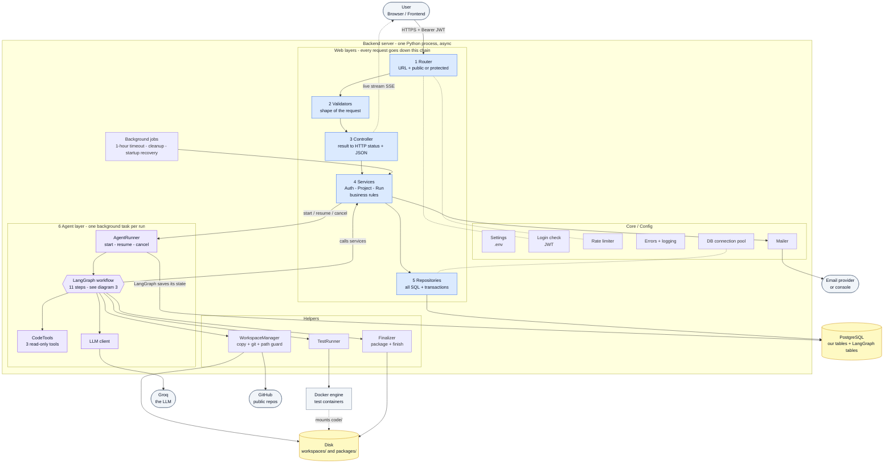
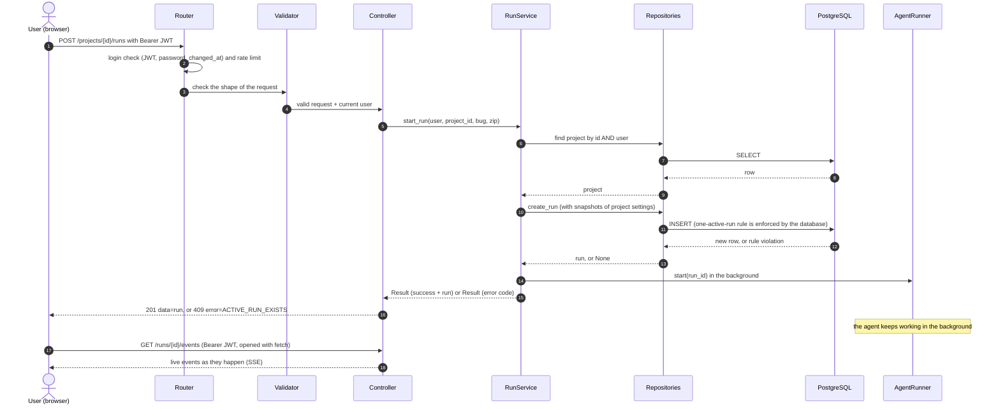
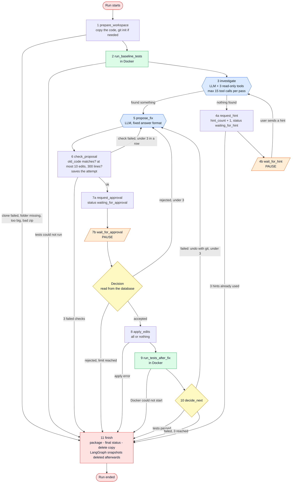
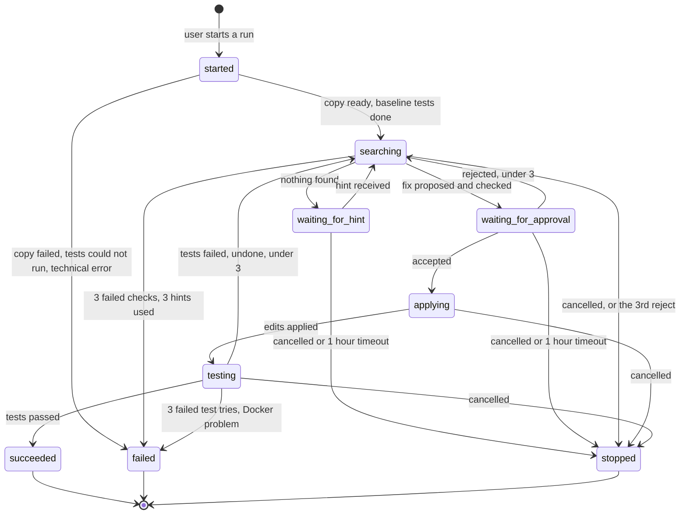
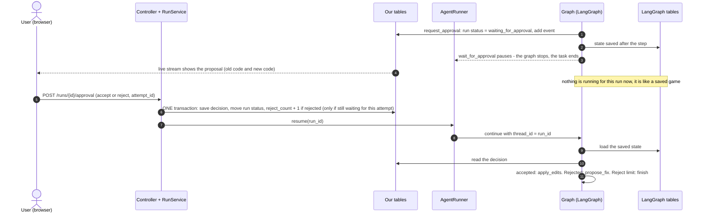
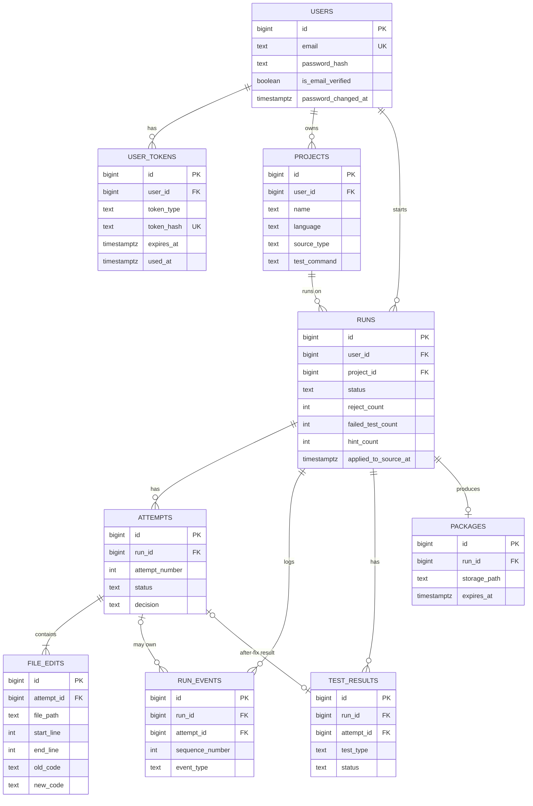

# SANGRA_AI - Workflow (System Architecture)

(Written in simple language. Date: 2026-10-22. Made from the design docs 01 to 04.)

This file shows the whole backend as pictures: how a request travels through the layers, where the agent sits inside the
backend, the agent's own workflow, the life of a run, the pause and resume, and how the tables link.

**How to view:** the diagrams are written in Mermaid. They show automatically on GitHub, in Obsidian, and in Typora. In VS Code,
install the extension "Markdown Preview Mermaid Support". Picture versions of every diagram are also in the `diagrams/` folder,
so you can open them in any image viewer.

## Shapes and colours

| Shape or line | Meaning |
|---|---|
| Rounded pill | Start, end, or something outside our backend (user, Groq, GitHub, email) |
| Rectangle | A part of the system, or a step of the agent |
| Hexagon | A step where the LLM thinks |
| Diamond | A decision |
| Slanted box (parallelogram, orange) | A PAUSE: the graph stops here and waits for the user |
| Cylinder | Storage (database or disk) |
| Solid arrow | A call or a flow |
| Dotted line | A connection that is only there to help (login check, live stream, mounted folder) |
| Blue | Web layers and LLM steps | 
| Green | Steps that run tests in Docker |
| Red | Ending steps |

---

## 1. The whole system, with the agent inside

Every request from the browser goes down the chain Router, Validators, Controller, Services, Repositories, and then to the database.
The agent is a separate layer inside the backend. Services start it, and its steps call the services back, so the layer rules stay
intact. LangGraph keeps its own tables in the same PostgreSQL, but our code never reads them.

## 2. One request through the layers (start a run)

The agent is started in the background, so the request answers at once. The live screen then follows the run through a stream.

## 3. The agent workflow (the graph)

This is the agent system architecture: 11 steps, with the two pauses (orange) and the limits (3 rejects, 3 failed test tries,
3 hints, 3 failed proposal checks, 15 tool calls per investigation). Every arrow that ends at "finish" ends the run.

## 4. The life of a run (its status)

A run moves between these statuses. A run is ACTIVE until it reaches succeeded, failed, or stopped. The database allows only one
active run per user. The baseline tests run while the status is still "started".

- succeeded: the tests passed.
- stopped: ended by the user's action or inaction (cancel, 1-hour timeout, 3 rejects).
- failed: everything else (limits reached, technical problems).

## 5. Pause and resume (the approval)

When the graph pauses, nothing is running for that run. It is like a saved game. The user's click is a normal web request: it saves
the decision in one transaction and then resumes the graph, which reads the decision from our database.

## 6. The tables and how they link

Nine tables of our own. LangGraph's tables are separate and are linked to our runs only by the label thread_id, which has the
same value as the run's id (there is no foreign key between them).

---

## Words to remember

- Run = the whole job. Attempt = one proposed fix (one try). Event = one line in the run's diary.
- The graph = the agent's flowchart. The state = the backpack it carries (only the agentic flow, not the app flow).
- thread_id = the label LangGraph uses to find its saved backpack. It is the same number as our run id.
- Two kinds of tokens: the JWT (kept by the browser, sent in the header on every request) and the email tokens (only in the email
  link, used once, never returned to the browser).

## Related documents

1. 01_brainstorm.md
2. 02_tech_stack.md
3. 03_database_design.md
4. 04_backend_design.md (router, validators, controller, service, repository, agent, core)
